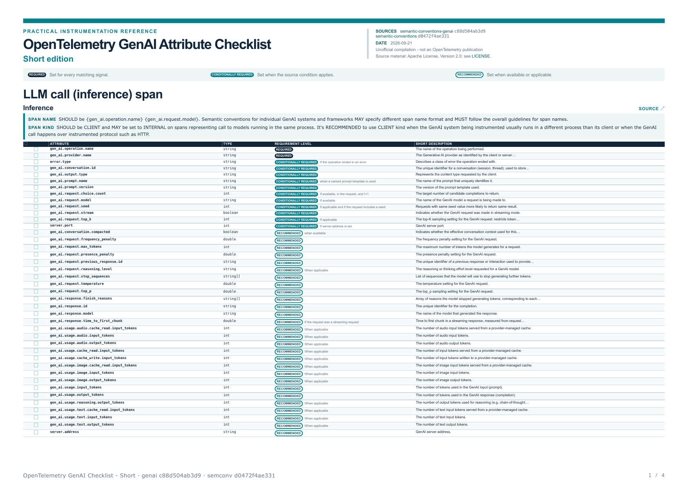

# OpenTelemetry GenAI Attribute Checklist

An unofficial, printable checklist compiled from pinned OpenTelemetry Generative AI semantic conventions.

- [Full checklist (48 pages)](dist/OpenTelemetry%20GenAI%20Attribute%20Checklist.pdf)
- [Short checklist (4 pages)](dist/OpenTelemetry%20GenAI%20Attribute%20Checklist%20-%20Short.pdf)



## Why this exists

OpenTelemetry moved the GenAI conventions to a new repository. The website now badges every current attribute as "Deprecated/Moved", which can make genuinely deprecated names hard to distinguish. There is no official checklist, so this project presents the pinned definitions as a practical reference.

## Build and verification

The generator reads snapshots pinned to `open-telemetry/semantic-conventions-genai@c88d504ab3d9879f8e50d3cc87e69775e11db234` and `open-telemetry/semantic-conventions@d0472f4ae331e8ef01aa571fe024d0d6a1a9b5e1`. Tests verify that every checklist attribute exists in the upstream registry snapshot and that no genuinely deprecated name appears in a checklist.

```sh
uv sync --dev
uv run pytest
uv run python build.py --edition full
uv run python build.py --edition short
```

To rebuild from newer upstream commits, update `SHA` and `LEGACY_SHA` in `fetch.py`, then run:

```sh
uv run python fetch.py
uv run pytest
uv run python build.py --edition full
uv run python build.py --edition short
```

Unofficial compilation - not an OpenTelemetry publication. Source links and pinned commits appear in each PDF. Compiled with AI assistance and verified by tests.

Licensed under Apache-2.0; see [LICENSE](LICENSE) and [NOTICE](NOTICE).
